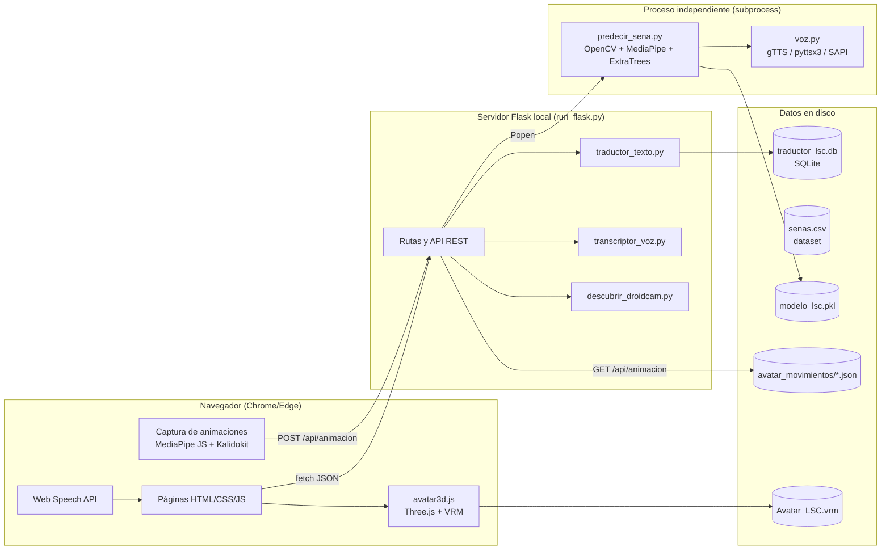
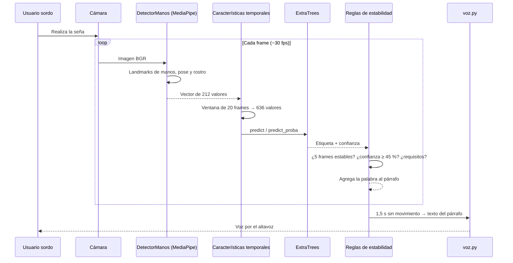
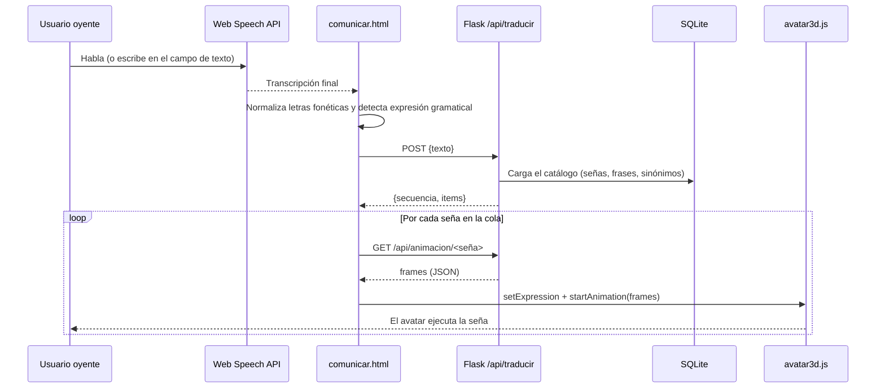
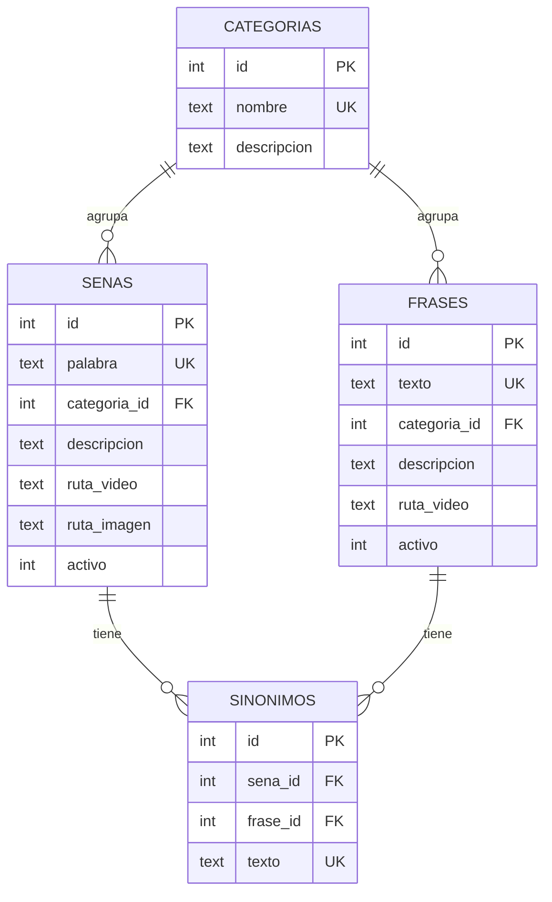

# Documentación técnica — LSCNOVA

**Traductor bidireccional de Lengua de Señas Colombiana (LSC) con Inteligencia Artificial**

| | |
|---|---|
| **Autores** | Rafael Zambrano · Jhoan Gómez |
| **Institución** | UNIPAZ — Ingeniería Informática · Semillero SISINFO |
| **Tipo de documento** | Documentación técnica del software (anexo del proyecto de grado) |
| **Versión del código documentada** | Rama `Staging`, commit `efa2fa2` + restauración de la ruta `/comunicar` |
| **Fecha** | Noviembre de 2026 |

---

## Contenido

1. [Propósito del documento](#1-propósito-del-documento)
2. [Descripción general del sistema](#2-descripción-general-del-sistema)
3. [Tecnologías utilizadas](#3-tecnologías-utilizadas)
4. [Arquitectura del software](#4-arquitectura-del-software)
5. [Estructura del repositorio](#5-estructura-del-repositorio)
6. [Flujo 1: Seña → Voz](#6-flujo-1-seña--voz)
7. [Flujo 2: Voz → Seña](#7-flujo-2-voz--seña)
8. [Base de datos de vocabulario](#8-base-de-datos-de-vocabulario)
9. [Rutas y API REST](#9-rutas-y-api-rest)
10. [Seguridad y configuración](#10-seguridad-y-configuración)
11. [Interfaz de usuario](#11-interfaz-de-usuario)
12. [Estado actual del modelo y resultados](#12-estado-actual-del-modelo-y-resultados)
13. [Pruebas automatizadas](#13-pruebas-automatizadas)
14. [Instalación y ejecución](#14-instalación-y-ejecución)
15. [Flujo de trabajo de desarrollo](#15-flujo-de-trabajo-de-desarrollo)
16. [Limitaciones y deuda técnica](#16-limitaciones-y-deuda-técnica)
17. [Trabajo futuro](#17-trabajo-futuro)
18. [Anexos](#18-anexos)

---

## 1. Propósito del documento

Este documento describe la construcción interna de LSCNOVA: su arquitectura, los módulos que lo componen, los algoritmos que usa, el formato de sus datos, la API que expone y el estado real del modelo de reconocimiento. Está dirigido a evaluadores técnicos y a futuros desarrolladores que necesiten entender, mantener o ampliar el sistema.

Todas las cifras (tamaño del dataset, precisión del modelo, número de registros de la base de datos) se obtuvieron directamente de los artefactos del proyecto en la fecha indicada en la portada.

---

## 2. Descripción general del sistema

LSCNOVA es una aplicación de escritorio para un aula con un computador fijo. Facilita la comunicación entre una persona sorda usuaria de la Lengua de Señas Colombiana y una persona oyente mediante dos flujos complementarios:

| Flujo | Entrada | Proceso | Salida |
|---|---|---|---|
| **1. Seña → Voz** | Cámara (webcam o celular con DroidCam) | MediaPipe Holistic extrae puntos clave del cuerpo y las manos; un clasificador ExtraTrees reconoce la seña | Texto en pantalla y voz sintetizada |
| **2. Voz → Seña** | Micrófono o texto escrito | Reconocimiento de voz (Web Speech API), normalización y traducción a una secuencia de señas usando la base de vocabulario | Avatar 3D (formato VRM) que ejecuta las señas, con expresiones faciales |

El sistema está diseñado exclusivamente para LSC. No se entrena con ASL ni con otras lenguas de señas, porque cada una tiene vocabulario, gramática y movimientos propios.

---

## 3. Tecnologías utilizadas

### 3.1 Backend y visión por computador (Python 3.10)

| Tecnología | Versión | Uso en el proyecto |
|---|---|---|
| Python | 3.10.11 | Lenguaje principal |
| Flask | 3.1.3 | Servidor web local, plantillas Jinja2 y API REST |
| OpenCV (`opencv-python`) | 4.13.0 | Captura de video, dibujo de la interfaz de la ventana de predicción |
| MediaPipe | 0.10.14 | Modelo *Holistic*: 21 puntos por mano, 33 de pose y malla facial |
| scikit-learn | 1.7.2 | Clasificadores RandomForest, ExtraTrees, HistGradientBoosting |
| NumPy / pandas | 2.2.6 / 2.3.3 | Cálculo numérico y carga del dataset |
| joblib | 1.5.3 | Serialización del modelo entrenado (`.pkl`) |
| SQLite (`sqlite3`) | estándar | Base de datos de vocabulario |
| gTTS + pygame | 2.5.4 / 2.6.1 | Síntesis de voz en línea con caché de MP3 |
| pyttsx3 | 2.99 | Síntesis de voz local (respaldo) |
| SpeechRecognition + Vosk | 3.16.1 / 0.3.45 | Transcripción de voz en el servidor (Google o Vosk sin conexión) |
| python-dotenv | 1.2.4 | Carga de credenciales desde `.env` |
| pytest | 9.1.1 | Pruebas unitarias |

### 3.2 Frontend (navegador)

| Tecnología | Versión | Uso en el proyecto |
|---|---|---|
| HTML5 / CSS3 / JavaScript (ES Modules) | — | Interfaz de usuario |
| Three.js | r160 (0.160.0) | Renderizado 3D del avatar con WebGL |
| `@pixiv/three-vrm` | 2.1.2 | Carga del modelo VRM, esqueleto humanoide y expresiones faciales |
| MediaPipe Holistic (JS) | 0.5.1675471629 | Seguimiento corporal en el navegador para capturar animaciones |
| Kalidokit | 1.1.0 | Convierte puntos de MediaPipe en rotaciones de huesos |
| Web Speech API | nativa de Chrome/Edge | Reconocimiento de voz en tiempo real |
| Web Audio API | nativa | Medidor de nivel del micrófono |

Las librerías de frontend se cargan desde la CDN `cdn.jsdelivr.net` mediante un *import map*. El modelo 3D (`static/models/Avatar_LSC.vrm`) se sirve localmente.

---

## 4. Arquitectura del software

### 4.1 Vista general

El sistema sigue una arquitectura cliente-servidor local: un servidor Flask corre en el mismo equipo y el navegador actúa como cliente. La predicción de señas corre en un proceso aparte, con ventana propia de OpenCV.



### 4.2 Capas

| Capa | Componentes | Responsabilidad |
|---|---|---|
| Presentación | `templates/*.html`, `static/css/style.css`, `static/js/*.js` | Interfaz, captura de voz, renderizado del avatar |
| Aplicación | `run_flask.py` | Enrutamiento, sesiones, lanzamiento de procesos, API JSON |
| Servicios | `src/services/*.py` | Traducción de texto, normalización, transcripción, red |
| Visión y aprendizaje automático | `src/detector_manos.py`, `src/caracteristicas_temporales.py`, `src/entrenar_modelo.py`, `src/predecir_sena.py`, `src/camara_stream.py` | Extracción de características, entrenamiento e inferencia |
| Datos | `src/database/*`, `data/`, `models/` | Persistencia de vocabulario, dataset, modelo y animaciones |

### 4.3 Modelo de procesos

- **Servidor Flask** (`run_flask.py`): se ejecuta en `127.0.0.1:5000` con `debug=False`. Al arrancar llama a `seed_database()` para garantizar que la base de datos exista y tenga el vocabulario inicial, y abre el navegador automáticamente después de 1,2 s.
- **Predicción** (`src/predecir_sena.py`): Flask la lanza con `subprocess.Popen`. En Windows usa `pythonw.exe` y la bandera `CREATE_NO_WINDOW`, de modo que solo aparece la ventana de la cámara, sin consola. Se decidió ejecutarla fuera del navegador porque la lectura de la cámara con OpenCV es más estable y de menor latencia que transmitir video al navegador.
- **Captura de dataset y entrenamiento**: se lanzan desde el modo programador con `CREATE_NEW_CONSOLE`, porque son herramientas interactivas que hacen preguntas en la terminal.

---

## 5. Estructura del repositorio

```text
traductor_lsc_ia/
├── run_flask.py                  # Punto de entrada: servidor Flask y API
├── app.py                        # [Legado] Interfaz anterior en Streamlit
├── requirements.txt              # Dependencias fijadas
├── .env.example                  # Plantilla de credenciales
├── data/
│   ├── senas.csv                 # Dataset de entrenamiento (características por muestra)
│   ├── traductor_lsc.db          # Base SQLite de vocabulario
│   ├── validacion_camara.csv     # Resultados de validación real con cámara
│   └── avatar_movimientos/       # Animaciones del avatar (un JSON por seña)
├── models/
│   ├── modelo_lsc.pkl            # Modelo entrenado (artefacto joblib)
│   └── vosk-model-small-es-0.42/ # Modelo de voz sin conexión (no versionado)
├── src/
│   ├── config.py                 # Rutas y constantes del vector de características
│   ├── camara_stream.py          # Abstracción de cámara local / IP
│   ├── detector_manos.py         # MediaPipe Holistic → vector de 212 valores
│   ├── caracteristicas_temporales.py  # Secuencia → vector de 636 valores
│   ├── capturar_dataset.py       # Captura de muestras para entrenamiento
│   ├── entrenar_modelo.py        # Entrenamiento y selección del mejor modelo
│   ├── predecir_sena.py          # Reconocimiento en tiempo real + voz
│   ├── validar_camara.py         # Prueba de precisión real con cámara
│   ├── voz.py                    # Síntesis de voz con respaldo en cascada
│   ├── capturar_avatar.py        # Captura de animaciones formato v1 (terminal)
│   ├── importar_lsc54.py         # Conversión del dataset externo LSC-54
│   ├── borrar_sena.py / ver_dataset.py / preparar_audios.py / probar_voz.py
│   ├── vocabulario_lsc.py        # Normalización de etiquetas
│   ├── capturar_video_lsc.py     # [Legado] Grabación de clips de video
│   ├── database/
│   │   ├── schema.sql            # Definición de tablas
│   │   ├── connection.py         # Conexión e inicialización
│   │   ├── seed.py               # Vocabulario inicial
│   │   └── registro_vocabulario.py  # Altas y consultas
│   └── services/
│       ├── traductor_texto.py    # Texto → secuencia de señas
│       ├── normalizacion.py      # Normalización y tokenización
│       ├── transcriptor_voz.py   # Audio → texto (Vosk / Google)
│       ├── descubrir_droidcam.py # URL de DroidCam
│       ├── landmarks_avatar.py   # Promedio de landmarks por seña
│       ├── avatar_animado.py     # [Legado] Avatar 2D para Streamlit
│       ├── avatar_lsc.py         # [Legado]
│       └── recursos_lsc.py       # [Legado]
├── static/
│   ├── js/avatar3d.js            # Motor del avatar 3D
│   ├── js/main.js                # Menú y acceso al modo programador
│   ├── css/style.css             # Estilos de toda la aplicación
│   └── models/Avatar_LSC.vrm     # Modelo 3D del avatar
├── templates/                    # Plantillas Jinja2 (ver sección 11)
├── tests/                        # Pruebas con pytest
└── docs/                         # Documentación
```

Los módulos marcados como **[Legado]** pertenecen a la primera versión de la interfaz, construida en Streamlit. La aplicación Flask actual no los usa; se conservan en el repositorio como referencia histórica.

---

## 6. Flujo 1: Seña → Voz



### 6.1 Captura de video — `src/camara_stream.py`

La clase `CamaraStream` unifica dos tipos de fuente:

| Fuente | Ejemplo | Estrategia |
|---|---|---|
| Cámara local | `0` | Lectura directa con `cv2.VideoCapture.read()` en el mismo hilo. No fuerza el tamaño de búfer para evitar congelamientos del backend MSMF de Windows. |
| Cámara IP (DroidCam) | `http://IP:4747/video` | Un hilo en segundo plano lee continuamente y conserva solo el último frame (`CAP_PROP_BUFFERSIZE = 1`). Así se descartan los frames acumulados en el búfer de red y se elimina el retraso. |

Ambos modos protegen el acceso a la cámara con un `threading.Lock`. La resolución solicitada es 1280×720 a 30 fps.

### 6.2 Detección de puntos clave — `src/detector_manos.py`

La clase `DetectorManos` envuelve MediaPipe Holistic con esta configuración:

| Parámetro | Valor |
|---|---|
| `model_complexity` | 1 |
| `smooth_landmarks` | `True` |
| `refine_face_landmarks` | `True` |
| `min_detection_confidence` | 0,7 |
| `min_tracking_confidence` | 0,7 |

De cada frame se obtienen:

- **Manos**: 21 puntos (x, y, z) por mano, para la mano izquierda y la derecha.
- **Cinco referencias corporales**, tomadas de la pose y, si la pose falla, de la malla facial:

| Referencia | Fuente principal | Respaldo |
|---|---|---|
| Nariz | Pose, punto 0 | Rostro, punto 1 |
| Boca | Promedio de pose 9 y 10 | Promedio de rostro 13 y 14 |
| Oreja izquierda | Pose, punto 7 | — |
| Oreja derecha | Pose, punto 8 | — |
| Pecho | Promedio de los hombros (pose 11 y 12) | — |

### 6.3 Vector de características por frame (212 valores)

Las dimensiones se definen en `src/config.py`. El vector no contiene imágenes: solo coordenadas y relaciones geométricas. Esto reduce el tamaño de los datos y permite usar clasificadores clásicos.

| Bloque | Cálculo | Valores |
|---|---|---|
| Landmarks de manos | 21 puntos × 3 coordenadas × 2 manos | 126 |
| Contexto por mano | 35 × 2 manos | 70 |
| Referencias corporales | 5 referencias × 3 coordenadas + ancho de hombros | 16 |
| **Total (`ENTRADA_MODELO`)** | | **212** |

Los 35 valores de contexto de cada mano son:

| Componente | Valores | Descripción |
|---|---|---|
| Presencia | 1 | 1,0 si la mano fue detectada |
| Punto de ubicación | 3 | Coordenadas de la **punta del dedo índice** (landmark 8). Se usa en lugar del centro de la palma porque muchas señas apuntan a la nariz, la boca, una oreja o el pecho. |
| Relación con cada referencia | 5 × 4 = 20 | Diferencia (dx, dy, dz) y distancia euclidiana a nariz, boca, orejas y pecho |
| Zona más cercana | 5 | Codificación *one-hot* de la referencia más cercana. Se mide en 2D (x, y) para que la profundidad estimada no confunda un dedo junto a la cara con el pecho. |
| Lado del cuerpo | 3 | *One-hot* izquierda / centro / derecha, con margen de 0,04 respecto al eje nariz–pecho |
| Altura | 3 | *One-hot* arriba / medio / abajo, con margen de 0,05 respecto al pecho |

Si una mano no aparece, su bloque se rellena con ceros. Si el vector resultante no mide 212, se completa o se recorta.

### 6.4 Características temporales (636 valores) — `src/caracteristicas_temporales.py`

Una seña es un movimiento, no una postura estática. Por eso el modelo recibe un resumen de una ventana de frames recientes (20 por defecto, `FRAMES_SECUENCIA`). Solo se consideran los frames donde hay al menos una mano.

Sea $F = [f_1, f_2, \dots, f_n]$ la secuencia de vectores de 212 valores:

| Componente | Fórmula | Qué representa |
|---|---|---|
| Postura actual | $f_n$ | Forma y ubicación de la mano al final |
| Desplazamiento | $f_n - f_1$ | Recorrido total del movimiento |
| Velocidad media | $\frac{1}{n-1}\sum_{i=2}^{n}(f_i - f_{i-1})$ | Dirección y rapidez promedio |

El vector final concatena los tres bloques: 3 × 212 = **636 valores** (`ENTRADA_MODELO_TEMPORAL`).

### 6.5 Captura del dataset — `src/capturar_dataset.py`

Herramienta de terminal para registrar muestras etiquetadas.

**Flujo:**

1. Elegir la cámara (local o DroidCam).
2. Elegir una seña existente (para sumarle muestras) o escribir una nueva.
3. Si es nueva, indicar su categoría y sinónimos opcionales. Se registra en SQLite mediante `registrar_sena()`.
4. Indicar la cantidad de muestras, el tipo de seña y el número de manos.
5. Por cada muestra: presionar `R`, esperar la cuenta regresiva de 3 s y hacer la seña.

**Tipos de seña:**

| Tipo | Frames grabados |
|---|---|
| Corta | 12 |
| Media | 20 |
| Larga | 32 |

**Reglas de calidad.** Una muestra solo se guarda si cumple todo lo siguiente; si no, se descarta para no ensuciar el entrenamiento:

- Al menos el 70 % de los frames muestran el número de manos requerido.
- La calidad promedio de la mano es ≥ 0,08. La calidad es la suma, entre las manos visibles, del lado mayor de su caja delimitadora en coordenadas normalizadas. Una mano lejana o mal iluminada da un valor bajo.
- El vector de características no es completamente nulo.
- No se puede iniciar la cuenta regresiva si la calidad es insuficiente en ese momento.

Cada muestra válida se agrega como una fila a `data/senas.csv`: `etiqueta, v1, v2, …, v636`.

La vista se muestra en modo espejo y dibuja las referencias corporales y la ubicación descriptiva de cada mano (por ejemplo, `oreja der | derecha | arriba`) para verificar que la seña se captura en la posición correcta.

### 6.6 Entrenamiento — `src/entrenar_modelo.py`

1. **Carga tolerante** (`cargar_dataset_variable`): lee el CSV fila por fila, toma la etiqueta de la primera columna y rellena con ceros las filas más cortas hasta el ancho máximo encontrado.
2. **División**: 80 % entrenamiento y 20 % prueba, estratificada por clase (`random_state=42`). Si alguna clase tiene menos de 2 muestras, se entrena y evalúa con el conjunto completo y se muestra una advertencia.
3. **Modelos candidatos**:

| Modelo | Hiperparámetros |
|---|---|
| `RandomForestClassifier` | 200 árboles, `class_weight="balanced_subsample"` |
| `ExtraTreesClassifier` | 300 árboles, `class_weight="balanced"` |
| `HistGradientBoostingClassifier` | 200 iteraciones, `learning_rate=0.08` |

4. **Selección**: se elige el modelo con mayor exactitud (*accuracy*) en el conjunto de prueba. Se imprime el reporte de clasificación por clase.
5. **Artefacto**: se guarda en `models/modelo_lsc.pkl` un diccionario con:

```python
{
    "modelo": <clasificador entrenado>,
    "nombre_modelo": "ExtraTrees",
    "precision": 0.9941,
    "modelos_evaluados": {"RandomForest": ..., "ExtraTrees": ..., "HistGradientBoosting": ...},
    "n_features": 636,
    "tipo_caracteristicas": "holistic_temporal"   # o "holistic_postura" si n_features ≤ 212
}
```

Se usa un solo hilo de CPU (`n_jobs=1` y variables `OMP/MKL/OPENBLAS_NUM_THREADS=1`) para evitar bloqueos en equipos modestos.

### 6.7 Predicción en tiempo real — `src/predecir_sena.py`

El script carga el artefacto, deduce si el modelo es temporal (`n_features > 212`) y procesa cada frame. No basta con que el modelo prediga una etiqueta: una máquina de estados decide cuándo esa predicción se convierte en una palabra y cuándo se pronuncia.

**Parámetros de decisión:**

| Parámetro | Valor | Propósito |
|---|---|---|
| Ventana temporal | 20 frames | Contexto de movimiento |
| Calidad mínima de mano | 0,08 | Pausar si la mano se ve pequeña o con poca luz |
| Frames estables mínimos | 5 | Exigir la misma predicción en 5 frames seguidos |
| Confianza mínima | 0,45 | Probabilidad máxima de `predict_proba` |
| Separación entre señas | 0,7 s | Evitar ráfagas de palabras |
| Umbral de movimiento | 0,003 | Diferencia media absoluta entre los landmarks de manos de dos frames |
| Pausa para hablar | 1,5 s sin movimiento | Momento en que se pronuncia el párrafo |

**Reglas:**

- **Etiquetas de control.** `sin_sena`, `reposo`, `ninguna`, `no_sena` y `transicion` (`ETIQUETAS_SIN_SENA`) nunca se agregan al texto. Sirven para que el modelo aprenda los momentos de no-seña y para reiniciar el estado.
- **Requisitos por seña.** `REQUISITOS_SENAS` define condiciones extra. Hoy, `saludos` exige 2 manos visibles en al menos 6 frames de la ventana, para no confundirla con `hola`.
- **Anti-repetición.** Una seña sostenida se agrega una sola vez (`sena_sostenida_bloqueada`). La misma palabra no se repite de forma consecutiva salvo que haya una pausa o una etiqueta de control entre ambas.
- **Repetición con sinónimo.** Si la misma seña aparece dos veces con pausa intermedia, la segunda se reemplaza por su primer sinónimo registrado en SQLite. Por ejemplo, `yo` + `yo` → «yo soy».
- **Voz.** Cuando pasan 1,5 s sin movimiento de manos y hay palabras pendientes, el párrafo se envía a `hablar_windows()` en un hilo aparte (protegido con un `Lock` para no superponer audios) y la pantalla se limpia.

**Atajos de teclado:** `Q` salir · `C` limpiar el párrafo · `V` pronunciar el párrafo de inmediato.

**Selección de cámara.** El script acepta `--fuente local|ip` y `--url`. Si se ejecuta desde la web sin terminal (`stdin` no interactivo), usa la cámara local. Si se ejecuta a mano, muestra un menú.

### 6.8 Síntesis de voz — `src/voz.py`

`hablar_windows(texto)` intenta tres motores en cascada:

| Orden | Motor | Requiere internet | Detalle |
|---|---|---|---|
| 1 | gTTS + pygame | Solo la primera vez por frase | Guarda el MP3 en `audio_cache/` (nombre legible o hash SHA-1) y lo reutiliza |
| 2 | pyttsx3 | No | Voz local del sistema, velocidad 165 |
| 3 | PowerShell + `System.Speech` (SAPI) | No | Último recurso en Windows. El texto se escapa como literal de PowerShell |

`src/preparar_audios.py` genera por adelantado los MP3 del vocabulario para que la predicción hable sin conexión.

### 6.9 Validación con cámara — `src/validar_camara.py`

Mide la precisión en condiciones reales, no solo sobre el conjunto de prueba. El usuario indica la seña esperada y la realiza durante N segundos (6 por defecto). El script registra cada predicción, toma la más frecuente como predicción final y agrega una fila a `data/validacion_camara.csv` con la fecha, la seña esperada, la predicción final, si fue correcta, los intentos válidos, la confianza promedio y máxima, y el detalle de confusiones.

---

## 7. Flujo 2: Voz → Seña



### 7.1 Reconocimiento de voz — `templates/comunicar.html`

Se usa la **Web Speech API** del navegador con estos parámetros:

| Propiedad | Valor |
|---|---|
| `lang` | `es-ES` |
| `continuous` | `false` |
| `interimResults` | `true` |
| `maxAlternatives` | 1 |

Con `continuous = true` el reconocimiento fallaba de forma intermitente en Chrome sobre Windows. Por eso se usa una sesión corta: cuando termina (`onend`) y el usuario sigue en modo escucha, se crea un objeto `SpeechRecognition` nuevo a los 100 ms (`crearReconocimiento()`). Reutilizar un objeto detenido fallaba sin mostrar error. Una comparación `rec !== recognition` evita que un objeto viejo reinicie la escucha.

La página también incluye:

- **Medidor de nivel** con la Web Audio API (`AnalyserNode`, FFT de 256), para comprobar que Chrome usa el micrófono correcto.
- **Campo de texto manual**, como alternativa cuando no hay micrófono o internet.
- **Mensajes de error** específicos para `no-speech`, `network` y `not-allowed`.

**Transcripción en el servidor (alternativa).** El endpoint `POST /api/transcribir` (`src/services/transcriptor_voz.py`) recibe un WAV y lo transcribe con **Vosk** sin conexión (modelo `vosk-model-small-es-0.42`) o con **Google** (`es-CO`) como respaldo. En modo `auto` intenta primero Vosk. La interfaz actual no lo usa, pero queda disponible para un escenario sin la API del navegador.

### 7.2 Normalización de letras fonéticas

Si la frase completa es el nombre de una letra (una o dos palabras), se convierte en la letra: «hache» → `h`, «jota» → `j`, «doble uve» → `w`, «i griega» → `y`, etc. Así se puede deletrear por voz.

### 7.3 Traducción de texto a secuencia de señas — `src/services/traductor_texto.py`

**Normalización** (`normalizacion.py`): minúsculas, `_` → espacio, eliminación de tildes por descomposición Unicode NFD (se conserva la `ñ`), eliminación de signos y compactación de espacios.

**Catálogo:** se carga desde SQLite como un diccionario `texto_normalizado → {texto, categoría, tipo, encontrado_por}` con todas las señas activas, las frases activas y los sinónimos. Cada sinónimo apunta a su seña o frase base.

**Algoritmo (coincidencia más larga primero):**

```text
i ← 0
mientras i < número de palabras:
    para largo desde min(5, palabras restantes) hasta 1:
        candidato ← palabras[i : i+largo] unidas con espacio
        si candidato está en el catálogo:
            agregar {catálogo[candidato], estado: "encontrada"}
            i ← i + largo
            continuar con la siguiente posición
    si no hubo coincidencia:
        agregar {texto: palabra, tipo: "deletreo", letras: [l1, l2, ...]}
        i ← i + 1
```

Se prueban frases de hasta 5 palabras antes que palabras sueltas, de modo que «buenos días» se traduce como una sola seña y no como «buenos» + «días».

**Ejemplo:**

| Entrada | Secuencia devuelta |
|---|---|
| `Hola, ¿cómo estás?` | `hola` · `como estas` |
| `buenos días profesor` | `buenos dias` · `profesor` |
| `muchas gracias profesor` | `gracias` · `profesor` (vía sinónimo) |
| `computador` | `c-o-m-p-u-t-a-d-o-r` (deletreo) |

Los sinónimos se cargan en el catálogo después de las señas y frases. Si un mismo texto existe como frase y como sinónimo, gana el sinónimo: «muchas gracias» está registrada como frase y como sinónimo de `gracias`, y el traductor devuelve `gracias`.

### 7.4 Cola de reproducción

Las señas se encolan (`colaSignos`) y se procesan de una en una:

1. Se toma la siguiente seña y se aplica su expresión facial (sección 7.6).
2. Se pide la animación con `GET /api/animacion/<seña>` y se guarda en caché en memoria.
3. Si existe animación, el avatar la reproduce. Al terminar vuelve a reposo y espera 650 ms antes de la siguiente.
4. Si no existe, el avatar queda semitransparente en reposo y el nombre de la seña se muestra en texto durante 900 ms.

### 7.5 Motor del avatar 3D — `static/js/avatar3d.js`

**Escena:** cámara en perspectiva (FOV 34°) enfocada en el torso, luz ambiental, luz principal y luz de relleno, y renderizado WebGL con espacio de color sRGB.

**Carga del modelo:** `GLTFLoader` con el plugin `VRMLoaderPlugin` carga `Avatar_LSC.vrm`. `VRMUtils.rotateVRM0` orienta el modelo hacia la cámara. Luego:

1. Se mapean **40 huesos** del esqueleto humanoide VRM 1.0: cabeza, cuello, dos de columna, tres por brazo (brazo, antebrazo, mano) y quince por mano (tres falanges por cada uno de los cinco dedos).
2. Se guardan las rotaciones de reposo y se calculan referencias corporales (nariz, boca, orejas, pecho, hombros) a partir de la posición real de los huesos.
3. Se bajan los brazos desde la pose en T a una posición natural (`_neutralArms`).

**Interpolación:** cada hueso guarda tres cuaterniones (origen, actual y destino). En cada cuadro de `requestAnimationFrame` se interpola con **SLERP** (interpolación esférica) y una curva de suavizado cuadrática. La transición hacia una pose dura 0,45 s; entre frames de una animación, 0,08 s.

**Reproducción:** `startAnimation(frames)` aplica un frame cada 50 ms (20 fps). Admite dos formatos:

| Formato | Contenido por frame | Cómo se aplica |
|---|---|---|
| **v2 — `rotaciones_v2`** (actual) | `bones: { nombreHuesoVRM: [qx, qy, qz, qw] }` | Copia directa de la rotación al hueso. Sin cálculos geométricos. |
| **v1 — landmarks** (anterior) | `der`/`izq`: 21 puntos normalizados; `ref`: codos, muñecas | Cinemática inversa (IK) de dos huesos para el brazo y orientación de cada falange hacia el siguiente punto. Se mantiene como respaldo hasta recapturar todas las señas. |

**API pública del módulo:**

| Función | Uso |
|---|---|
| `initAvatar(canvasId, onReady)` | Crea la escena y carga el VRM |
| `startAnimation(frames, onDone)` / `stopAnimation()` | Reproduce o detiene una seña |
| `clearPose()` | Regresa a reposo |
| `applyLiveRotations(bonesMap)` | Aplica rotaciones al instante (captura en vivo) |
| `snapshotRotations()` | Devuelve la rotación actual de cada hueso (para grabar un frame v2) |
| `setExpression(nombre, intensidad, duración)` / `clearExpression()` | Expresiones faciales |

**Parpadeo automático:** cada 3 a 6 s (aleatorio) el avatar cierra los ojos en 60 ms y los abre en 100 ms.

### 7.6 Expresiones faciales

En LSC la expresión facial es parte de la gramática (marca preguntas, negaciones, intensidad). El sistema la genera por código, con los *blendshapes* del VRM, con dos niveles de prioridad:

**Expresión léxica** (propia de la seña, tiene prioridad):

| Seña | Expresión | Intensidad |
|---|---|---|
| `hola`, `saludos` | `happy` | 0,45 |
| `bien` | `happy` | 0,25 |
| `mal` | `sad` | 0,60 |
| `ayuda` | `surprised` | 0,50 |
| `sordo` | `relaxed` | 0,30 |
| `yo`, `tu` | `relaxed` | 0,20 |

**Expresión gramatical** (se detecta en la frase completa y se aplica a las señas sin expresión léxica):

| Condición | Expresión | Intensidad |
|---|---|---|
| Empieza con `¿` o termina con `?` | `surprised` (cejas arriba, pregunta) | 0,55 |
| Empieza con `¡` o termina con `!` | `happy` | 0,65 |
| Contiene «no», «nunca», «jamás», «nada», «nadie» | `angry` (ceño, negación) | 0,30 |

La expresión se mantiene entre las señas de una misma frase y se limpia cuando la cola queda vacía. Las expresiones no se capturan con cámara; fue una decisión deliberada para mantenerlas controladas y consistentes.

### 7.7 Captura de animaciones para el avatar

**Captura en el navegador (formato v2)** — `/dev/capturar-avatar`, `templates/dev/capturar_avatar.html`:

1. La webcam alimenta a MediaPipe Holistic (JS) en cada cuadro.
2. **Kalidokit** convierte los puntos en rotaciones de Euler: `Pose.solve` para los brazos (con un factor de amortiguación de 0,9) y `Hand.solve` para cada mano.
3. Las rotaciones se convierten a cuaterniones y se aplican **en vivo** al avatar (`applyLiveRotations`). El programador ve al avatar imitarlo mientras hace la seña.
4. Al grabar, cada frame guarda `snapshotRotations()` hasta completar la duración elegida (corta 15, media 25 o larga 40 frames).
5. La toma se reproduce en bucle para revisarla. Se puede **guardar** (`POST /api/animacion/<seña>`) o **descartar y regrabar**.

El principio de este diseño es que **lo que se ve al grabar es exactamente lo que se reproduce**. Las rotaciones se resuelven una sola vez, al capturar, y no se reconstruyen con heurísticas al reproducir. Esto elimina los errores de dedos y huesos mal orientados del formato v1.

**Captura en terminal (formato v1)** — `src/capturar_avatar.py`: herramienta anterior que guarda landmarks normalizados (origen en la nariz, escala igual a la distancia nariz–pecho) junto con referencias de hombros, codos y orejas. Exige que el 75 % de los frames tengan mano y cuerpo. Se conserva por compatibilidad.

**Estructura de un archivo v2** (`data/avatar_movimientos/<seña>.json`; los valores numéricos son ilustrativos):

```json
{
  "sena": "hola",
  "categoria": "cortesia",
  "manos": "1",
  "duracion": "media",
  "formato": "rotaciones_v2",
  "version": 2,
  "fps": 30,
  "total_frames": 25,
  "frames": [
    { "f": 0, "bones": { "rightUpperArm": [0.01, -0.12, 0.64, 0.75], "rightHand": [ ... ], ... } }
  ]
}
```

Al guardar sobre una seña existente, el archivo anterior se renombra a `<seña>.bak.json`.

---

## 8. Base de datos de vocabulario

### 8.1 Modelo entidad-relación



### 8.2 Reglas de integridad

- Las claves foráneas están activas (`PRAGMA foreign_keys = ON`) en cada conexión.
- Cada sinónimo pertenece **o** a una seña **o** a una frase, nunca a ambas ni a ninguna. Lo garantiza una restricción `CHECK`.
- `palabra`, `texto` y `nombre` son únicos. Todos los textos se guardan normalizados (sección 7.3).
- Hay índices sobre `senas.categoria_id` y `frases.categoria_id`.
- El campo `activo` permite ocultar una seña o frase del traductor sin borrarla.

### 8.3 Datos iniciales — `src/database/seed.py`

`seed_database()` es idempotente (usa `INSERT … ON CONFLICT DO UPDATE` e `INSERT OR IGNORE`) y se ejecuta en cada arranque del servidor. Carga:

- **12 categorías**: cordialidad, colores, números, alfabeto, familia, acciones, objetos, personas, pronombres, estados, control y neutro.
- **28 señas** iniciales (por ejemplo `hola`, `gracias`, `por favor`, `ayuda`, `profesor`, `sordo`, `yo`, `tu`, `bien`, `mal`, colores y números del 1 al 3), con sus sinónimos.
- **3 frases**: «buenos días», «cómo estás» y «muchas gracias».

Estado actual de la base: 12 categorías, 35 señas (las iniciales más las registradas durante la captura), 3 frases y 28 sinónimos.

**Reglas lingüísticas del vocabulario:**

- `hola` y `saludos` son señas distintas. `saludo` es sinónimo de `saludos`, no de `hola`.
- `sordo` no tiene sinónimos.
- Los sinónimos sirven para entender texto o voz transcrita; no son etiquetas nuevas del modelo. Si dos palabras se hacen con gestos distintos, se capturan como señas distintas.

---

## 9. Rutas y API REST

Todas las rutas están en `run_flask.py`. «Dev» indica que exige la sesión del modo programador.

### 9.1 Páginas

| Método | Ruta | Acceso | Plantilla / acción |
|---|---|---|---|
| GET | `/` | Público | `index.html` con el número de muestras, de clases y el estado del modelo |
| GET | `/predecir` | Público | `predecir.html`: selector de cámara y lanzador |
| GET | `/comunicar` | Público | `comunicar.html`: voz/texto → avatar |
| GET | `/aprender` | Público | `aprender.html`: abecedario, saludos, números y frases |
| GET | `/acerca` | Público | `acerca.html`: información del proyecto |
| GET | `/dev` | Dev | Panel del programador con estadísticas |
| GET | `/dev/capturar` | Dev | Lanzador de captura del dataset |
| GET | `/dev/capturar-avatar` | Dev | Captura de animaciones en el navegador |
| GET | `/dev/entrenar` | Dev | Lanzador de entrenamiento |
| GET | `/dev/dataset` | Dev | Tabla de muestras por seña |

Las rutas Dev sin sesión muestran `dev/login_requerido.html`.

### 9.2 API JSON

| Método | Ruta | Acceso | Entrada | Respuesta |
|---|---|---|---|---|
| POST | `/predecir/lanzar` | Público | `{"fuente": "local" \| "ip", "url"?: "http://…"}` | `{"ok": true, "url"?}` o `{"ok": false, "error"}` (400). Valida que la URL use `http`/`https`. |
| GET | `/api/camara/droidcam` | Público | — | `{"ok": true, "ip", "puerto": 4747, "url"}` |
| POST | `/api/traducir` | Público | `{"texto": "hola como estas"}` | `{"ok": true, "secuencia": ["hola", "como estas"], "items": [...]}` |
| POST | `/api/transcribir` | Público | `multipart/form-data`: `audio` (WAV), `motor` = `auto` \| `vosk` \| `google` | `{"ok": true, "texto", "motor"}` |
| GET | `/api/animacion/<seña>` | Público | — | `{"ok": true, ...contenido del JSON}` o 404 |
| POST | `/api/animacion/<seña>` | Dev | JSON con `frames` | `{"ok": true, "frames": N}`; 403 sin sesión, 400 sin `frames` |
| GET | `/api/landmarks/<seña>` | Público | — | Landmarks promedio de la seña en el dataset (usado por el avatar anterior) |
| GET | `/api/landmarks` | Público | — | Lista de señas presentes en el dataset |
| POST | `/api/dev/login` | Público | `{"password"}` | `{"ok": true}` o 401 / 403 |
| POST | `/api/dev/logout` | Público | — | `{"ok": true}` |
| POST | `/dev/capturar/lanzar` | Dev | — | Abre `capturar_dataset.py` en una consola nueva |
| POST | `/dev/entrenar/lanzar` | Dev | — | Abre `entrenar_modelo.py` en una consola nueva |

**Ejemplo — traducción:**

```http
POST /api/traducir
Content-Type: application/json

{"texto": "hola profesor"}
```

```json
{
  "ok": true,
  "secuencia": ["hola", "profesor"],
  "items": [
    {"texto": "hola", "categoria": "cordialidad", "tipo": "palabra", "encontrado_por": "hola", "estado": "encontrada"},
    {"texto": "profesor", "categoria": "personas", "tipo": "palabra", "encontrado_por": "profesor", "estado": "encontrada"}
  ]
}
```

---

## 10. Seguridad y configuración

| Aspecto | Implementación |
|---|---|
| Credenciales fuera del código | Se leen de `.env` con `python-dotenv`. El archivo no se versiona; `.env.example` sirve de plantilla. |
| Llave de sesión | `LSC_SECRET_KEY`. Si falta, se genera una aleatoria (`secrets.token_hex(32)`) y las sesiones se pierden al reiniciar. |
| Modo programador | `LSC_DEV_PASSWORD`. Si está vacía, el modo queda deshabilitado. La comparación usa `secrets.compare_digest` (tiempo constante). |
| Autorización | Las rutas `/dev/*` y la escritura de animaciones verifican `session["dev"]`. |
| Superficie de red | Flask escucha en `127.0.0.1`: solo es accesible desde el mismo equipo. |
| Validación de entradas | La URL de cámara se valida con `urlparse` (esquema y host). El texto a traducir se normaliza antes de cualquier búsqueda. |
| Consultas SQL | Todas usan parámetros (`?`), sin concatenar texto. |
| Respaldo de datos | Guardar una animación no destruye la anterior: la renombra a `.bak.json`. |

---

## 11. Interfaz de usuario

La interfaz usa una plantilla base (`base.html`) con barra de navegación, enlace para saltar al contenido (accesibilidad), modal de acceso al modo programador y pie de página. El diseño es adaptable: en pantallas angostas el menú se vuelve desplegable y las cuadrículas pasan a una columna.

| Página | Función |
|---|---|
| **Inicio** | Presentación, accesos directos a los dos flujos y estadísticas del dataset |
| **Seña a voz** | Pasos de uso, selector de cámara (equipo o DroidCam), botón para iniciar la predicción y recomendaciones de luz y encuadre |
| **Voz a seña** | Estado del micrófono, medidor de nivel, transcripción parcial y final, cola de señas, campo de texto y avatar 3D |
| **Aprender** | Pestañas de abecedario, saludos, números y frases con su glosa LSC (por ejemplo, «¿Cómo te llamas?» → `NOMBRE TU ¿?`) |
| **Proyecto** | Información académica |
| **Programador** | Panel con estadísticas, captura del dataset, entrenamiento, tabla del dataset (con semáforo según el número de muestras: ≥ 50, ≥ 30, < 30) y captura de animaciones |

---

## 12. Estado actual del modelo y resultados

### 12.1 Dataset (`data/senas.csv`)

**1 695 muestras en 18 clases.**

| Seña | Muestras | | Seña | Muestras |
|---|---:|---|---|---:|
| `tu` | 215 | | `a` | 79 |
| `bien` | 210 | | `sin_sena` | 50 |
| `sordo` | 199 | | `ninguna` | 50 |
| `yo` | 180 | | `ayuda` | 45 |
| `hola` | 140 | | `e` | 20 |
| `mal` | 130 | | `reposo` | 9 |
| `saludos` | 103 | | `como_estas` | 3 |
| `c` | 90 | | `no` | 2 |
| `d` | 90 | | | |
| `b` | 80 | | | |

**Origen de los datos.** El dataset se construyó en varias etapas a medida que evolucionó el vector de características. Por eso contiene filas de tres anchos:

| Ancho | Filas | Corresponde a |
|---:|---:|---|
| 190 | 849 | Primera versión: postura de un solo frame, sin las codificaciones de zona, lado y altura. Incluye 90 filas importadas del dataset público **LSC-54** (`ayuda` y `bien`) mediante `src/importar_lsc54.py`. |
| 570 | 198 | Primera versión temporal (3 × 190) |
| 636 | 648 | Versión actual (3 × 212) |

Durante el entrenamiento las filas cortas se completan con ceros hasta 636 columnas (ver la sección 16).

### 12.2 Modelo entrenado (`models/modelo_lsc.pkl`, 22 de octubre de 2026)

| Modelo | Exactitud en prueba |
|---|---:|
| **ExtraTrees** (seleccionado) | **99,41 %** |
| HistGradientBoosting | 98,82 % |
| RandomForest | 98,53 % |

- Conjunto de prueba: 20 % estratificado (339 muestras).
- Entrada: 636 características (`holistic_temporal`).
- 18 clases, 300 árboles, `class_weight="balanced"`.

### 12.3 Validación real con cámara (`data/validacion_camara.csv`, 3 de mayo de 2026)

| Seña esperada | Predicción final | Predicciones correctas | Confianza promedio | Confusiones |
|---|---|---|---:|---|
| `hola` | `hola` ✔ | 88 / 88 | 89,85 % | — |
| `sordo` | `sordo` ✔ | 185 / 196 | 73,67 % | `hola` (11) |
| `yo` | `yo` ✔ | 129 / 131 | 44,87 % | `sordo` (2) |
| `tu` | `tu` ✔ | 135 / 187 | 45,69 % | `saludos` (31), `sordo` (12), `yo` (5), `bien` (3), `mal` (1) |

Hubo además un primer intento con `yo` sin predicciones válidas (mano no detectada con calidad suficiente). Esta validación se hizo con un modelo anterior al actual (el vigente se entrenó el 22 de octubre de 2026), por lo que conviene repetirla con el modelo actual antes de reportar resultados finales.

**Interpretación.** La exactitud en el conjunto de prueba (99,41 %) es mucho más alta que la confianza observada en cámara para algunas señas (≈ 45 % en `yo` y `tu`). La diferencia se explica porque las muestras de prueba provienen de las mismas sesiones de captura que las de entrenamiento (misma persona, luz y encuadre), lo que hace la evaluación optimista. La validación con cámara es la medida más representativa del uso real.

### 12.4 Animaciones del avatar

Hay 2 animaciones disponibles (`hola` y `bien`), ambas en formato v1. El formato v2 y su herramienta de captura están implementados; falta recapturar el vocabulario con ellos (sección 17).

---

## 13. Pruebas automatizadas

Se usa **pytest**. Para ejecutarlas:

```powershell
venv\Scripts\python.exe -m pytest -q
```

| Archivo | Qué verifica | Casos |
|---|---|---:|
| `tests/test_normalizacion.py` | `normalizar_texto` (mayúsculas, tildes, `_`, signos, espacios) y `tokenizar` | 9 |
| `tests/test_descubrir_droidcam.py` | Formato de la URL de DroidCam y armado con la IP de la red (con `monkeypatch`) | 2 |
| **Total** | | **11 (todas pasan)** |

`tests/conftest.py` agrega la raíz del proyecto al `sys.path` para que los imports `src.*` funcionen.

Además de las pruebas unitarias, la precisión del reconocimiento se verifica con `src/validar_camara.py` (sección 6.9).

---

## 14. Instalación y ejecución

La guía paso a paso está en [`docs/guia_instalacion.md`](guia_instalacion.md). En resumen:

```powershell
# 1. Entorno e instalación
python -m venv venv
venv\Scripts\pip.exe install -r requirements.txt

# 2. Credenciales
copy .env.example .env      # completar LSC_SECRET_KEY y LSC_DEV_PASSWORD

# 3. Ejecutar
venv\Scripts\python.exe run_flask.py    # abre http://127.0.0.1:5000
```

**Requisitos:** Windows 10/11, Python 3.10, cámara web, micrófono, Chrome o Edge (Brave bloquea la Web Speech API) y conexión a internet para el reconocimiento de voz del navegador y para descargar las librerías 3D desde la CDN.

**Archivos que no están en el repositorio** y deben copiarse aparte: `.env`, `models/modelo_lsc.pkl`, `models/vosk-model-small-es-0.42/` y, si se quiere conservar, el dataset completo.

**Herramientas de línea de comandos:**

| Comando | Función |
|---|---|
| `python src/capturar_dataset.py` | Capturar muestras |
| `python src/entrenar_modelo.py` | Entrenar y guardar el mejor modelo |
| `python src/predecir_sena.py [--fuente local\|ip] [--url URL]` | Predicción en tiempo real |
| `python src/validar_camara.py` | Validación real con cámara |
| `python src/ver_dataset.py` | Resumen del dataset |
| `python src/borrar_sena.py <seña>` | Eliminar una seña del dataset |
| `python src/database/seed.py` | Inicializar o actualizar la base de datos |
| `python src/preparar_audios.py` | Generar los MP3 del vocabulario |
| `python src/capturar_avatar.py` | Capturar una animación v1 (terminal) |
| `python src/importar_lsc54.py` | Convertir datos del dataset LSC-54 |

---

## 15. Flujo de trabajo de desarrollo

Definido en `CONTRIBUTING.md`:

- Ramas de trabajo creadas desde `Staging`. No se hacen commits directos a `main` ni a `Staging`.
- Pull request de la rama a `Staging` y luego de `Staging` a `main` (producción).
- Las pruebas deben pasar antes de abrir un PR.
- El dataset, el modelo y las credenciales no se suben al repositorio.
- El código y los comentarios se escriben en español.

---

## 16. Limitaciones y deuda técnica

### 16.1 Reconocimiento (Flujo 1)

1. **Dataset con esquemas mezclados.** Las filas de 190 y 570 valores se completan con ceros hasta 636, pero sus columnas no corresponden semánticamente a las del esquema actual. Por ejemplo, en una fila antigua la columna 130 es un valor de contexto con otra posición y significado que en una fila nueva. Las clases que solo existen en esquemas antiguos (`ayuda`, `reposo`, `sin_sena`, `ninguna`) se aprenden a partir de patrones que nunca aparecen en la cámara en vivo, que siempre produce 636 valores con el esquema actual. **Recomendación:** recapturar esas clases con la herramienta actual o descartar las filas antiguas antes de reentrenar.
2. **Evaluación optimista.** La división aleatoria por filas mezcla muestras muy correlacionadas de la misma sesión. Una división por sesión o por persona daría una estimación más realista.
3. **Clases desbalanceadas.** `como_estas` (3), `no` (2) y `reposo` (9) tienen muy pocas muestras para aprenderse bien.
4. **Un solo firmante.** La mayoría de las muestras propias provienen de la misma persona; el modelo puede no generalizar a otras personas.
5. **Predicción fuera del navegador.** El reconocimiento corre en una ventana de OpenCV aparte, no dentro de la página web.
6. **URL de DroidCam.** La URL se arma con la IP del computador (`ip_de_la_red()`). La aplicación DroidCam sirve el video desde el celular, por lo que en una red WiFi la dirección correcta es la del celular. Conviene verificar este caso o permitir escribir la IP manualmente.

### 16.2 Traducción y avatar (Flujo 2)

1. **Pocas animaciones.** Solo `hola` y `bien` tienen animación, y en formato v1. Las demás señas se muestran como texto.
2. **Deletreo sin animación.** Una palabra desconocida llega como una sola cadena (`c-o-m-p-u…`). La interfaz busca una animación con ese nombre completo, no la reproduce letra por letra.
3. **Traducción palabra a palabra.** El traductor no aplica gramática LSC (orden, omisión de artículos y verbos copulativos). Produce una secuencia de señas siguiendo el orden del español.
4. **Dependencia de internet.** La Web Speech API y las librerías 3D (CDN) requieren conexión. Sin internet queda el campo de texto, pero el avatar no carga.
5. **Navegador.** La Web Speech API solo funciona en Chrome y Edge.
6. **Frase opacada por un sinónimo.** «muchas gracias» está registrada como frase y como sinónimo de `gracias`; como el sinónimo gana, la frase nunca se usa. Hay que decidir cuál de los dos registros conservar.
7. **Velocidad de reproducción.** La reproducción usa 20 fps fijos, mientras que la captura en el navegador graba al ritmo al que MediaPipe entrega resultados y el archivo declara 30 fps. Una seña puede reproducirse más lenta o más rápida que como se grabó.

### 16.3 Código

1. **Código heredado.** `app.py` (Streamlit), `avatar_animado.py`, `avatar_lsc.py`, `recursos_lsc.py` y `capturar_video_lsc.py` ya no se usan desde Flask. Los endpoints `/api/landmarks*` tampoco los usa la interfaz actual.
2. **Nombre de seña en rutas de archivo.** `/api/animacion/<seña>` construye la ruta del archivo con el nombre recibido. Conviene restringirlo a caracteres seguros (`[a-z0-9_ ]`) para impedir rutas fuera de `data/avatar_movimientos/`.
3. **Conexiones SQLite.** `with get_connection()` confirma la transacción pero no cierra la conexión. Funciona en una aplicación local de un solo usuario, pero es mejor cerrarla de forma explícita.
4. **Texto insertado como HTML.** `comunicar.html` agrega la frase traducida con `innerHTML`. Usar `textContent` evitaría que un texto con etiquetas HTML se interprete.
5. **Parámetros duplicados.** `elegir_camara()` y los parámetros de calidad se repiten en varios scripts; podrían centralizarse en `config.py`.

---

## 17. Trabajo futuro

| Línea | Descripción |
|---|---|
| **Completar el avatar por rotaciones (Cambio 1)** | Recapturar el vocabulario (`hola`, `bien`, `yo`, `tu`, `ayuda`, `sordo`, `mal`, …) con la herramienta del navegador en formato v2 y eliminar el código de cinemática inversa del formato v1. |
| **Gramática a glosa (Cambio 2)** | Módulo basado en reglas y diccionario para un dominio acotado (aula y presentación personal). En Voz → Seña: reordenar, omitir y marcar pregunta o negación antes de buscar las señas; los marcadores alimentarían las expresiones faciales. En Seña → Voz: convertir la secuencia reconocida en español natural, formalizando las reglas actuales de repetición y sinónimos. Las reglas se validarán con la comunidad sorda (CASD José Prudencio Padilla). |
| **Calidad del dataset** | Unificar el esquema de características, ampliar el vocabulario, incluir varios firmantes y evaluar por sesión o por persona. |
| **Deletreo animado** | Separar las palabras deletreadas en letras y reproducir la animación de cada una. |
| **Reconocimiento en el navegador** | Llevar la predicción a la página web (MediaPipe JS y el modelo exportado o servido por la API). |
| **Funcionamiento sin conexión** | Servir Three.js, three-vrm y MediaPipe desde `static/` y usar Vosk como reconocedor de voz por defecto. |
| **Arquitectura distribuida** | Servidor central (Flask/FastAPI + MariaDB) para distribuir modelo y vocabulario a varias instituciones, y cliente instalable empaquetado con PyInstaller con actualización automática. |

---

## 18. Anexos

### 18.1 Constantes de configuración (`src/config.py`)

| Constante | Valor | Significado |
|---|---:|---|
| `LANDMARKS_POR_MANO` | 63 | 21 puntos × 3 coordenadas |
| `MAX_MANOS` | 2 | Manos consideradas |
| `REFERENCIAS_CUERPO` | 5 | Nariz, boca, oreja izquierda, oreja derecha, pecho |
| `CARACTERISTICAS_CONTEXTO_POR_MANO` | 35 | 1 + 3 + 20 + 5 + 3 + 3 |
| `CARACTERISTICAS_REFERENCIAS_CUERPO` | 16 | 5 × 3 + ancho de hombros |
| `ENTRADA_MODELO` | 212 | Vector por frame |
| `ENTRADA_MODELO_TEMPORAL` | 636 | 3 × 212 |
| `FRAMES_SECUENCIA` | 20 | Ventana temporal |
| `MIN_FRAMES_MANO_CAPTURA` | 14 | Frames mínimos con mano (referencia) |
| `ETIQUETAS_SIN_SENA` | 5 etiquetas | `sin_sena`, `reposo`, `ninguna`, `no_sena`, `transicion` |
| `REQUISITOS_SENAS` | `saludos` | 2 manos en ≥ 6 frames |

### 18.2 Glosario

| Término | Definición |
|---|---|
| **LSC** | Lengua de Señas Colombiana. |
| **Landmark** | Punto clave del cuerpo (articulación, punta de dedo) con coordenadas normalizadas x, y, z, entregado por MediaPipe. |
| **MediaPipe Holistic** | Modelo de Google que detecta simultáneamente la pose corporal, las manos y el rostro en video. |
| **ExtraTrees** | *Extremely Randomized Trees*: conjunto de árboles de decisión cuyos umbrales de corte se eligen al azar; reduce la varianza y entrena rápido. |
| **One-hot** | Codificación de una categoría como un vector con un 1 en su posición y 0 en las demás. |
| **VRM** | Formato abierto de avatares 3D humanoides basado en glTF, con esqueleto estandarizado y expresiones faciales. |
| **Blendshape** | Deformación predefinida de la malla de un modelo 3D (por ejemplo, sonrisa o cejas arriba) que se mezcla con una intensidad de 0 a 1. |
| **Cuaternión** | Representación matemática de una rotación en 3D (x, y, z, w) sin los bloqueos de los ángulos de Euler. |
| **SLERP** | *Spherical Linear Interpolation*: interpolación entre dos cuaterniones que produce una rotación suave y de velocidad constante. |
| **IK (cinemática inversa)** | Cálculo de los ángulos de las articulaciones necesarios para que un extremo (la mano) llegue a una posición dada. |
| **Kalidokit** | Librería que convierte landmarks de MediaPipe en rotaciones de huesos para avatares VRM. |
| **Glosa** | Representación escrita de una frase en lengua de señas que respeta su gramática (por ejemplo, `YO AYUDA NECESITAR`). |
| **DroidCam** | Aplicación que convierte un celular en cámara IP accesible por WiFi en el puerto 4747. |
| **Web Speech API** | Interfaz del navegador para reconocimiento y síntesis de voz. |
